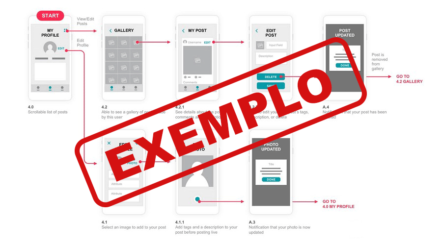
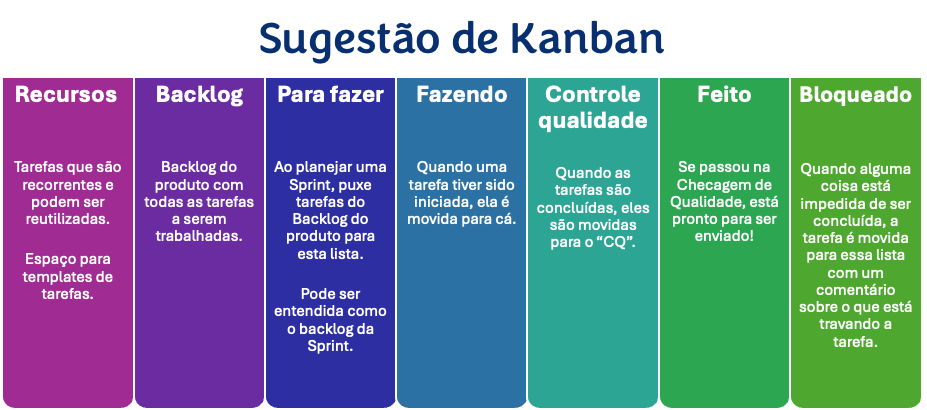
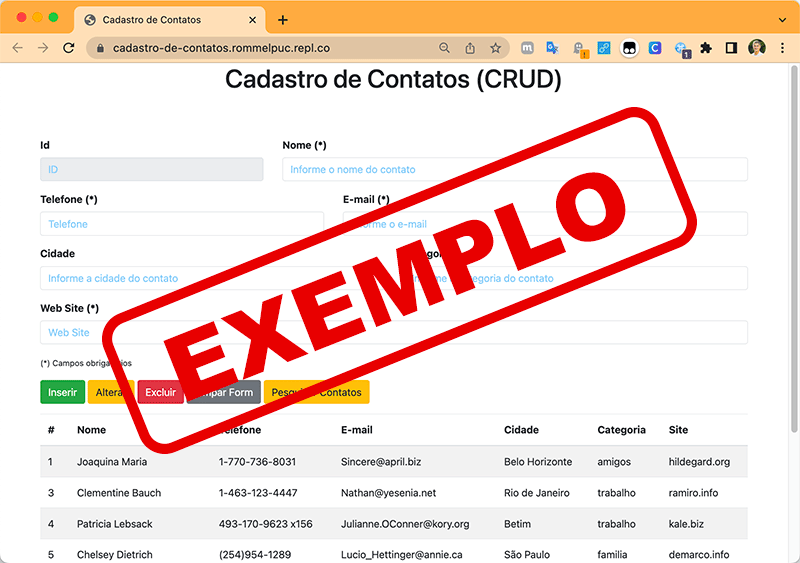

# Introdução

Informações básicas do projeto.

* **Projeto:** [HERÓIS DA SAÚDE]
* **Repositório GitHub:** [https://github.com/ICEI-PUC-Minas-CC-TI/pmg-cc-2026-2-ti2-6168100-pmg-cc-2026-2-ti2-6168100-group-4]
* **Membros da equipe:**
  * Antônio Victor Oliveira Gonçalves
  * [Diogo de Sá Cavalcanti Araujo](https://github.com/Odsfidoij) 
  * [Eduardo Augusto Freitas Nogueira](https://github.com/eduardoaugustofn)
  * [Miguel Schiavon Britto](https://github.com/mschiavon21)
  * [Pedro Luiz dos Santos Alves](https://github.com/PedrolzAlves) 
  * [Thiago Duarte Machado](https://github.com/Thz002) 

  

Este documento acompanha a evolução do projeto ao longo das duas fases da disciplina: primeiro a fase de **Estratégia**, guiada pelo Design Thinking, em que entendemos o problema e projetamos a solução; depois a fase de **Implementação**, guiada pelo Scrum, em que construímos a aplicação ao longo de três sprints.

✅ [Template de Design Thinking (Miro)](https://miro.com/app/board/uXjVHvBpxSM=/)

## Sumário

1. [Contexto](#contexto)
   * [Problema](#problema) · [Objetivos](#objetivos) · [Justificativa](#justificativa) · [Público-Alvo](#público-alvo)
2. [Product Discovery](#product-discovery)
   * [Mapa de Stakeholders](#mapa-de-stakeholders) · [Matriz CSD](#matriz-csd) · [Pesquisa de Campo](#pesquisa-de-campo) · [Personas](#personas)
3. [Product Design](#product-design)
   * [Proposta de Valor](#proposta-de-valor) · [Histórias de Usuários](#histórias-de-usuários) · [Requisitos](#requisitos) · [User Story Map e Definição do MVP](#user-story-map-e-definição-do-mvp) · [Projeto de Interface](#projeto-de-interface)
4. [Metodologia](#metodologia)
   * [Ferramentas](#ferramentas) · [Gerenciamento do Projeto](#gerenciamento-do-projeto)
5. [Solução Implementada](#solução-implementada)
   * [Vídeo do Projeto](#vídeo-do-projeto) · [Funcionalidades](#funcionalidades) · [Minimundo](#minimundo) · [Estruturas de Dados](#estruturas-de-dados) · [Módulos e APIs](#módulos-e-apis)
6. [Referências](#referências)

---

# Contexto

Detalhes sobre o espaço de problema, os objetivos do projeto, sua justificativa e público-alvo.

## Problema

Crianças e adolescentes têm pouco contato com informação de saúde em uma linguagem que entendam. Termos médicos, nomes de doenças e orientações de prevenção costumam ser explicados de forma técnica, o que dificulta o entendimento e afasta esse público do assunto. Isso contribui para a desinformação em saúde desde cedo, num momento em que hábitos e noções básicas ainda estão se formando.Além disso, muitas instituições apresentam déficit no ensino de temas de saúde, área fundamental para a formação do cidadão.


</details>

## Objetivos

Desenvolver uma aplicação web gamificada que apresente conceitos de saúde para o público infanto-juvenil de forma clara, lúdica e acessível. O sistema permite que professores organizem turmas e acompanhem o progresso dos alunos, e que os alunos aprendam por meio de dinâmicas interativas em vez de conteúdo puramente expositivo. Aliando a experiência técnica do ensino com a interação ativa e gamificada, proporcionando um ensino de melhor qualidade.

</details>

## Justificativa

A educação em saúde é mais efetiva quando começa cedo, mas raramente é apresentada de forma atrativa para crianças. Um jogo digital aproveita o interesse natural desse público por dinâmicas interativas para transmitir conhecimento que normalmente seria passado de forma tradicional. O projeto une conteúdo validado pela área de Medicina com uma aplicação construída pela Computação, aproveitando o trabalho interdisciplinar para gerar uma ferramenta com propósito real.
</details>

## Público-Alvo

O público principal são crianças e adolescentes em idade escolar, que interagem diretamente com o jogo. De forma secundária, há a figura do educador ou responsável — como professores, pais ou tutores — que pode organizar turmas e acompanhar o progresso dos jovens. Embora o contexto escolar seja um cenário natural de uso, a aplicação não depende exclusivamente dele: o acompanhamento pode ser feito por qualquer adulto responsável, e o conteúdo também pode ser explorado de forma mais autônoma pelo próprio jovem.

</details>

---

# Product Discovery

Nesta etapa, aprofundamos a compreensão do problema escolhido a partir da perspectiva de quem o vivencia. O grupo levanta evidências de campo — não suposições — e as converte em artefatos que sustentam as decisões de produto tomadas na etapa de Product Design.

## Mapa de Stakeholders


</details>

## Matriz CSD


</details>

## Pesquisa de Campo

**Roteiro de Entrevista**
ROTEIRO DE ENTREVISTA 

Olá! Obrigado por participar desta conversa. Estamos fazendo uma pesquisa sobre educação em saúde para crianças e adolescentes — como esse público entra em contato com informação sobre saúde, quais são as dificuldades e o que poderia tornar esse aprendizado mais efetivo. Não existe resposta certa ou errada: queremos entender a sua percepção e a sua experiência sobre o tema. Sinta-se à vontade para responder abertamente. Sua opinião é muito importante para o nosso trabalho. 

1. Como você vê a educação em saúde para crianças e jovens atualmente? Quais são os principais desafios? 

2. Na sua opinião, qual seria uma forma efetiva de ensinar sobre saúde para eles? Qual seria a vantagem dessa forma em relação aos métodos tradicionais? 

3. O que você acha que faria uma criança ou adolescente se interessar por aprender sobre saúde? 

4. Que tipos de conteúdo sobre saúde você considera mais importante para o público jovem aprender nessa idade? 

5. Qual seria a importância de crianças aprenderem sobre o SUS e os profissionais de saúde? 

6. Quais você acredita que seriam os principais desafios de um projeto envolvendo esse tema? O que não poderia funcionar? 

7. Pensando em uma abordagem interativa, como seria trabalhado caso o jovem tivesse dificuldade com o tema abordado? Isso poderia desanimar? 

8. Como poderiam ser feitas abordagens diferentes que se adaptam conforme a idade do público-alvo? 

9. Em qual contexto diário — casa ou escola — você acha mais interessante? 

10. No contexto escolar, qual seria o papel do professor para tornar esse aprendizado mais efetivo? 

11. Você acha que o público-alvo teria dificuldade em compreender alguns cenários profissionais de saúde? 

12. Considerando a realidade em relação ao conhecimento na área da saúde, como você acha que o projeto deveria abordar questões relacionadas a acesso à saúde e medicamentos? 

13. Qual seria a melhor forma de transmitir a importância do acesso a esse conhecimento para pais e responsáveis? 

14. Na sua visão, qual seria o maior impacto positivo que essa conscientização poderia ter na educação e na saúde do público-alvo?

**Entrevistados**

Gabriel - 15 anos - Aluno do 1º ano do ensino médio
Cristiane Marinho - 45 anos - Professora do 5º ano


**Hilights**


</details>

## Personas


</details>

---

# Product Design

Nesse momento, vamos transformar os insights e validações obtidos em soluções tangíveis e utilizáveis. Essa fase envolve a definição de uma proposta de valor, a redação das histórias de usuário, a organização de tudo em um User Story Map e a criação de wireframes, mockups e protótipos que detalham a interface e a experiência do usuário.

## Proposta de Valor

### Proposta para Persona Isabela Campos 


### Proposta para Persona Guilherme Silva


### Proposta para Persona Claudia Mendes


</details>

## Histórias de Usuários

Com base na análise das personas foram identificadas as seguintes histórias de usuários:

1 -  Como aluno quero ter uma opção de estudo não conveniconal para aprender de uma forma mais confortavel.
2 - Como estudante desejo aprender sobre assuntos de saúde para conseguir evitar o mal-estar.
3 - Como professor quero ter outra opção de metódo de ensino para fugir dos meios comuns e exaustivos para os alunos.
4 - Como professor desejo garantir aos meus alunos conhecimentos realmente úteis para suas vidas para que eles sejam capazes de cuidar de sua saúde.
5 -  Como médico gostaria que meus paciente possuissem um leve conhecimento sobre saúde para facilitar a nossa interação e conpreensão.
6 -  Como médico quero ajudar os mais novos a aprenderem como se cuidarem para que a proxima geração seja mais conciente e saúdavel.
7 - Como professor, quero criar turmas, para organizar meus alunos.
8 - Como professor, quero um código de acesso para cada turma, para que os alunos entrem na turma certa.
9 - Como professor, quero acompanhar o progresso da turma, para saber quais temas reforçar.
10 - Como aluno, quero entrar em uma turma usando um código, para acessar as atividades.
11- Como aluno, quero jogar as dinâmicas sobre saúde, para aprender de forma interativa.
12 - Como aluno, quero visualizar meu progresso, para saber o que já aprendi e o que falta.

</details>

## Requisitos

As tabelas que se seguem apresentam os requisitos funcionais e não funcionais que detalham o escopo do projeto.

### Requisitos Funcionais

| ID | Descrição do Requisito | Prioridade |
| ------ | ------------------------------------------------------------------------------------------------ | ---------- |
| RF-001 | O sistema deve permitir que o professor crie turmas e adicione alunos | ALTA |
| RF-002 | O sistema deve permitir que o aluno tenha um perfil/avatar próprio | MÉDIA |
| RF-003 | O sistema deve apresentar quizes com perguntas sobre temas de saúde (física, mental, alimentar, sexual etc.) | ALTA |
| RF-004 | O sistema deve dar algum tipo de pontuação ou progresso conforme o aluno responde | ALTA |
| RF-005 | O sistema deve mostrar mensagens de incentivo quando o aluno errar, sem punir | MÉDIA |
| RF-006 | O sistema deve permitir que o professor veja o desempenho da turma e de cada aluno | MÉDIA |
| RF-007 | O sistema deve permitir que o professor crie ou escolha os quizes que vai aplicar | MÉDIA |
| RF-008 | O sistema deve tratar temas mais sensíveis (sexualidade, saúde mental) com uma abordagem cuidadosa e adequada à idade | ALTA |
| RF-009 | O sistema deve separar o conteúdo dos quizes por faixa etária/nível | MÉDIA |
| RF-010 | O sistema deve exibir conquistas/medalhas conforme o aluno avança no jogo | BAIXA |

### Requisitos não Funcionais

| ID | Descrição do Requisito | Prioridade |
| ------- | ------------------------------------------------------------------------------------------------ | ---------- |
| RNF-001 | O sistema deve ser desenvolvido usando Node.js, HTML e CSS no front, com Supabase (PostgreSQL) no banco de dados | ALTA |
| RNF-002 | O código deve ser versionado com Git e hospedado no GitHub | ALTA |
| RNF-003 | O sistema deve ser responsivo (funcionar bem no celular também) | ALTA |
| RNF-004 | O conteúdo dos quizes deve ser confiável e adequado à faixa etária dos alunos | ALTA |

### Restrições do Projeto
 
| ID | Descrição da Restrição |
| ----- | ------------------------------------------------------------------------------------------------ |
| RE-001 | O projeto deve ser desenvolvido dentro do prazo definido pelo cronograma da disciplina |
| RE-002 | O sistema deve utilizar apenas serviços e ferramentas gratuitas (sem orçamento para hospedagem paga), por se tratar de um protótipo acadêmico |

<details>

</details>

## User Story Map e Definição do MVP

**✳️✳️✳️ COLOQUE AQUI O SEU USER STORY MAP ✳️✳️✳️**

<details>
<summary>⚠️ Como preencher esta seção (apague antes de entregar)</summary>

O User Story Map organiza todas as histórias de usuário em uma visão única do produto, ordenadas pela jornada do usuário (linha) e pela prioridade (coluna). É a partir dele que o grupo recorta o Produto Mínimo Viável (MVP) e distribui o restante do backlog entre as três sprints da fase de Implementação.

Indique claramente, no seu User Story Map: (1) quais histórias compõem o MVP; (2) em qual sprint (1, 2 ou 3) cada fatia do backlog será desenvolvida.

**Orientações**:

- [User Story Mapping: o que é e como fazer](https://www.atlassian.com/br/agile/project-management/user-story-mapping)

</details>

## Projeto de Interface

Artefatos relacionados com a interface e a interacão do usuário na proposta de solução.

### Wireframes

Estes são os protótipos de telas do sistema.

#### TELA XPTO ⚠️ EXEMPLO ⚠️

Descrição para a tela XPTO


**✳️✳️✳️ COLOQUE AQUI OS PROTÓTIPOS DE TELAS COM TÍTULO E DESCRIÇÃO ✳️✳️✳️**

<details>
<summary>⚠️ Como preencher esta seção (apague antes de entregar)</summary>

Wireframes são protótipos das telas da aplicação usados em design de interface para sugerir a estrutura de um site web e seu relacionamentos entre suas páginas. Um wireframe web é uma ilustração semelhante ao layout de elementos fundamentais na interface.

**Orientações**:

- [Ferramentas de Wireframes](https://rockcontent.com/blog/wireframes/)
- [Figma](https://www.figma.com/)
- [Adobe XD](https://www.adobe.com/br/products/xd.html#scroll)
- [MarvelApp](https://marvelapp.com/developers/documentation/tutorials/)

</details>

### User Flow



**✳️✳️✳️ COLOQUE AQUI O DIAGRAMA DE FLUXO DE TELAS ✳️✳️✳️**

<details>
<summary>⚠️ Como preencher esta seção (apague antes de entregar)</summary>

Fluxo de usuário (User Flow) é uma técnica que permite ao desenvolvedor mapear todo fluxo de telas do site ou app. Essa técnica funciona para alinhar os caminhos e as possíveis ações que o usuário pode fazer junto com os membros de sua equipe.

**Orientações**:

- [User Flow: O Quê É e Como Fazer?](https://medium.com/7bits/fluxo-de-usu%C3%A1rio-user-flow-o-que-%C3%A9-como-fazer-79d965872534)
- [User Flow vs Site Maps](http://designr.com.br/sitemap-e-user-flow-quais-as-diferencas-e-quando-usar-cada-um/)
- [Top 25 User Flow Tools &amp; Templates for Smooth](https://www.mockplus.com/blog/post/user-flow-tools)

</details>

### Protótipo Interativo

✅ [Protótipo Interativo (MarvelApp)](https://marvelapp.com/prototype/4hd6091?emb=1&iosapp=false&frameless=false)  ⚠️ EXEMPLO ⚠️

**✳️✳️✳️ COLOQUE AQUI UM IFRAME COM SEU PROTÓTIPO INTERATIVO ✳️✳️✳️**

<details>
<summary>⚠️ Como preencher esta seção (apague antes de entregar)</summary>

Um protótipo interativo apresenta o projeto de interfaces e permite ao usuário navegar pelas funcionalidades como se estivesse lidando com o software pronto. Utilize as mesmas ferramentas de construção de wireframes para montagem do seu protótipo interativo. Inclua o link para o protótipo interativo do projeto.

</details>

---

# Metodologia

Detalhes sobre a organização do grupo e o ferramental empregado.

## Ferramentas

Relação de ferramentas empregadas pelo grupo durante o projeto.

| Ambiente                    | Plataforma | Link de acesso                                     |
| --------------------------- | ---------- | -------------------------------------------------- |
| Processo de Design Thinking | Miro       | https://miro.com/XXXXXXX ⚠️ EXEMPLO ⚠️        |
| Repositório de código     | GitHub     | https://github.com/XXXXXXX ⚠️ EXEMPLO ⚠️      |
| Hospedagem do site          | Render     | https://site.render.com/XXXXXXX ⚠️ EXEMPLO ⚠️ |
| Protótipo Interativo       | MarvelApp  | https://marvelapp.com/XXXXXXX ⚠️ EXEMPLO ⚠️   |

<details>
<summary>⚠️ Como preencher esta seção (apague antes de entregar)</summary>

Liste as ferramentas empregadas no desenvolvimento do projeto, justificando a escolha delas, sempre que possível. Inclua itens como: (1) editor de código, (2) ferramentas de comunicação, (3) ferramentas de diagramação, (4) plataformas de hospedagem, entre outras.

</details>

## Gerenciamento do Projeto

Divisão de papéis no grupo e apresentação da estrutura da ferramenta de controle de tarefas (Kanban), utilizada para acompanhar o backlog do produto e o andamento das três sprints.



<details>
<summary>⚠️ Como preencher esta seção (apague antes de entregar)</summary>

Nesta parte do documento, você deve apresentar o processo de trabalho baseado nas metodologias ágeis, a divisão de papéis e tarefas, as ferramentas empregadas e como foi realizada a gestão de configuração do projeto via GitHub.

Coloque detalhes sobre o processo de Design Thinking e a implementação do Framework Scrum seguido pelo grupo. O grupo poderá fazer uso de ferramentas on-line para acompanhar o andamento do projeto, a execução das tarefas e o status de desenvolvimento da solução.

**Orientações**:

- [Sobre Projects - GitHub Docs](https://docs.github.com/pt/issues/planning-and-tracking-with-projects/learning-about-projects/about-projects)
- [Gestão de projetos com GitHub | balta.io](https://balta.io/blog/gestao-de-projetos-com-github)
- [(460) GitHub Projects - YouTube](https://www.youtube.com/playlist?list=PLiO7XHcmTsldZR93nkTFmmWbCEVF_8F5H)
- [11 Passos Essenciais para Implantar Scrum no seu Projeto](https://mindmaster.com.br/scrum-11-passos/)
- [Scrum em 9 minutos](https://www.youtube.com/watch?v=XfvQWnRgxG0)

</details>

---

# Solução Implementada

Esta seção apresenta todos os detalhes da solução criada no projeto.

## Vídeo do Projeto

O vídeo a seguir traz uma apresentação do problema que a equipe está tratando e a proposta de solução. ⚠️ EXEMPLO ⚠️

[](https://www.youtube.com/embed/70gGoFyGeqQ)

<details>
<summary>⚠️ Como preencher esta seção (apague antes de entregar)</summary>

O vídeo de apresentação é voltado para que o público externo possa conhecer a solução. O formato é livre, sendo importante que seja apresentado o problema e a solução numa linguagem descomplicada e direta. Inclua um link para o vídeo do projeto.

</details>

## Funcionalidades

Esta seção apresenta as funcionalidades da solução.

### Funcionalidade 1 - Cadastro de Contatos ⚠️ EXEMPLO ⚠️

Permite a inclusão, leitura, alteração e exclusão de contatos para o sistema

* **Estrutura de dados:** Contatos
* **Instruções de acesso:**
  * Abra o site e efetue o login
  * Acesse o menu principal e escolha a opção Cadastros
  * Em seguida, escolha a opção Contatos
* **Tela da funcionalidade**:



<details>
<summary>⚠️ Como preencher esta seção (apague antes de entregar)</summary>

Apresente cada uma das funcionalidades que a aplicação fornece tanto para os usuários quanto aos administradores da solução.

Inclua, para cada funcionalidade, itens como: (1) título e descrição da funcionalidade; (2) estrutura de dados associada; (3) instruções de acesso e uso.

</details>

## Minimundo

**✳️✳️✳️ DESCREVA AQUI O MINIMUNDO DO SEU NEGÓCIO ✳️✳️✳️**

<details>
<summary>⚠️ Como preencher esta seção (apague antes de entregar)</summary>

O minimundo é uma descrição textual do negócio por trás da sua aplicação: quais são as principais entidades envolvidas (por exemplo, usuários, produtos, pedidos), como elas se relacionam entre si e quais regras de negócio existem. É a partir dessa descrição que o grupo desenha o modelo de dados apresentado na seção seguinte.

</details>

## Estruturas de Dados

Descrição das estruturas de dados utilizadas na solução, com exemplos no formato JSON. No projeto, os dados ficam armazenados no arquivo `codigo/db/db.json` e são servidos automaticamente pelo **JSON Server**: cada chave de nível superior desse arquivo vira uma coleção com sua própria API RESTful (`GET`, `POST`, `PUT`, `DELETE`), sem que seja necessário programar um banco de dados à parte.

### Estrutura de Dados - Contatos ⚠️ EXEMPLO ⚠️

Contatos da aplicação

```json
{
  "id": 1,
  "nome": "Leanne Graham",
  "cidade": "Belo Horizonte",
  "categoria": "amigos",
  "email": "Sincere@april.biz",
  "telefone": "1-770-736-8031",
  "website": "hildegard.org"
}
```

### Estrutura de Dados - Usuários ⚠️ EXEMPLO ⚠️

Registro dos usuários do sistema, utilizado para login e para o perfil do sistema

```json
{
  "id": 1,
  "login": "admin",
  "senha": "123",
  "nome": "Administrador do Sistema",
  "email": "admin@abc.com"
}
```

<details>
<summary>⚠️ Como preencher esta seção (apague antes de entregar)</summary>

Apresente as estruturas de dados utilizadas na solução, tanto para os dados que fazem parte da essência da aplicação quanto outras estruturas criadas para algum tipo de configuração. Nomeie a estrutura, coloque uma descrição sucinta e apresente um exemplo em formato JSON correspondente a uma das coleções do `db.json`.

**Orientações:**

- [JSON Introduction](https://www.w3schools.com/js/js_json_intro.asp)
- [Trabalhando com JSON - Aprendendo desenvolvimento web | MDN](https://developer.mozilla.org/pt-BR/docs/Learn/JavaScript/Objects/JSON)

</details>

## Módulos e APIs

Esta seção apresenta os módulos e APIs utilizados na solução.

**Images**:

* Unsplash - [https://unsplash.com/](https://unsplash.com/) ⚠️ EXEMPLO ⚠️

**Fonts:**

* Icons Font Face - [https://fontawesome.com/](https://fontawesome.com/) ⚠️ EXEMPLO ⚠️

**Scripts:**

* jQuery - [http://www.jquery.com/](http://www.jquery.com/) ⚠️ EXEMPLO ⚠️
* Bootstrap 4 - [http://getbootstrap.com/](http://getbootstrap.com/) ⚠️ EXEMPLO ⚠️

<details>
<summary>⚠️ Como preencher esta seção (apague antes de entregar)</summary>

Apresente os módulos e APIs utilizados no desenvolvimento da solução. Inclua itens como: (1) frameworks, bibliotecas, módulos, etc. utilizados no desenvolvimento da solução; (2) APIs utilizadas para acesso a dados, serviços, etc.

</details>

---

# Referências

As referências utilizadas no trabalho foram:

* SOBRENOME, Nome do autor. Título da obra. 8. ed. Cidade: Editora, 2000. 287 p ⚠️ EXEMPLO ⚠️

<details>
<summary>⚠️ Como preencher esta seção (apague antes de entregar)</summary>

Inclua todas as referências (livros, artigos, sites, etc.) utilizados no desenvolvimento do trabalho.

**Orientações**:

- [Formato ABNT](https://www.normastecnicas.com/abnt/trabalhos-academicos/referencias/)
- [Referências Bibliográficas da ABNT](https://comunidade.rockcontent.com/referencia-bibliografica-abnt/)

</details>
